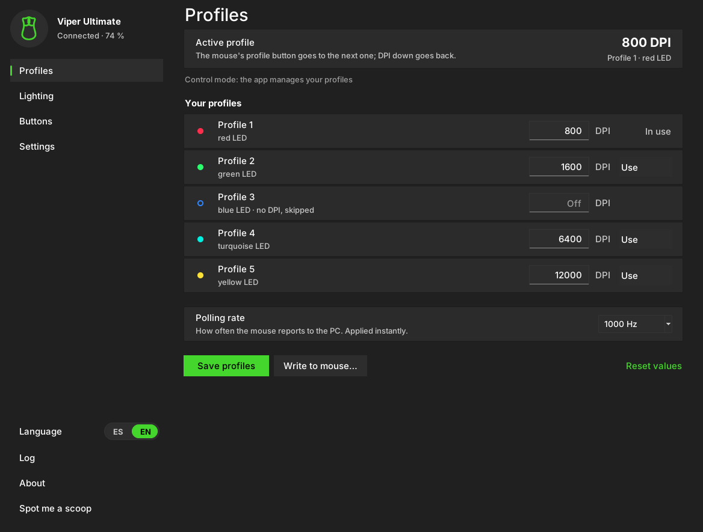

> 🌐 **[English](README.md)** · **[Español](README.es.md)**

# Non-Synapse-Mouse

**Configurador ligero para ratones Razer, sin Razer Synapse.**

<p align="center">
  
</p>

Razer Synapse ocupa espacio, corre servicios en segundo plano, consume RAM y te pide
una cuenta solo para cambiarle el DPI al ratón. **Non-Synapse-Mouse** hace ese
trabajo con comunicación directa con el ratón (los mismos *feature reports* HID que
manda Synapse): **sin servicios en segundo plano intrusivos, sin nube, sin cuenta y
sin instalar drivers.** Funciona en Windows.

> ⚠️ Proyecto independiente de la comunidad. **No está afiliado a Razer ni
> respaldado por Razer.** Software libre (**GPL-3.0**), se ofrece *tal cual*, **sin
> garantías**.

**[Descargar la última versión](https://github.com/Damnedapa/Non-Synapse-Mouse/releases/latest)** · [Historial de cambios](CHANGELOG.md)

---

## Índice
- [De dónde viene](#de-dónde-viene)
- [Qué hace](#qué-hace)
- [Limitaciones](#limitaciones)
- [Modelos compatibles](#modelos-compatibles)
- [Requisitos](#requisitos)
- [Uso rápido](#uso-rápido)
- [Si vienes de la v1.0.0](#si-vienes-de-la-v100)
- [Cómo funcionan los perfiles](#cómo-funcionan-los-perfiles)
- [Remapeo de botones](#remapeo-de-botones)
- [Crear el .exe](#crear-el-exe)
- [Cómo funciona por dentro](#cómo-funciona-por-dentro)
- [Archivo de configuración](#archivo-de-configuración)
- [Solución de problemas](#solución-de-problemas)
- [Seguridad, privacidad y aviso legal](#seguridad-privacidad-y-aviso-legal)
- [Créditos](#créditos)
- [Licencia](#licencia)

---

## De dónde viene

Synapse siempre me pareció un despropósito: RAM y procesos en segundo plano, cuenta
y conexión, para algo tan simple como fijar un DPI o un color. La idea era
configurar el ratón y quitarme el software de encima.

Es posible gracias a **[OpenRazer](https://github.com/openrazer/openrazer)**
(**GPL-2.0**), que lleva años descifrando por ingeniería inversa los dispositivos
Razer, pero solo para Linux. De su código se tomaron y **verificaron** los comandos y
las estructuras del protocolo. Este programa **no copia código de OpenRazer**: el
protocolo está reimplementado en Python. El mérito de la ingeniería inversa es de
OpenRazer y su comunidad. **Gracias.**

Para que el proyecto **siga siendo libre** (que nadie lo cierre y lo venda), se
publica bajo **GPL-3.0**.

## Qué hace

**Perfiles, como Synapse**
- Con el programa abierto, **toma el control del botón de perfil del ratón** y cambia
  entre **tus 5 perfiles de DPI al instante y sin fallos**. *DPI abajo* vuelve al
  anterior.
- Editas el DPI de cada perfil en el programa y pulsas **Usar** para activar uno. Se
  aplican nada más abrir el programa.
- Los perfiles internos del ratón **no se tocan** salvo que decidas grabarlos; al
  cerrar el programa, el ratón vuelve a su modo normal.
- **Grabar en el ratón:** un asistente guiado guarda tus perfiles en la memoria del
  propio ratón, color a color (rojo, verde, azul, turquesa, amarillo), y comprueba
  cada uno. Así los tienes con el programa cerrado o en otro PC. Además, al cerrar el
  programa te ofrece hacerlo.
- **Aviso** opcional al cambiar de perfil: una tarjeta con el color del perfil, una
  barra de 5 tramos y el nivel de batería.
- Al pasar el ratón por el **icono de la bandeja** se ve el perfil activo, su DPI y la
  batería; con clic derecho puedes **cambiar de perfil** desde su menú.
- **Parpadeo del logo:** al cambiar de perfil, el LED del logo parpadea tres veces con
  el color del perfil (como un intermitente) y vuelve a como estaba. Opcional.

**Todo lo demás**
- **Conexión automática:** encuentra el ratón solo y se reconecta si lo desenchufas o
  se duerme. Autodetecta cualquier Razer, aunque no esté en la lista.
- **Frecuencia de sondeo** de 125 / 500 / 1000 Hz, aplicada en cuanto la eliges.
- **Iluminación (LED del logo):** interruptor de encendido, color desde una paleta
  rápida o con un **selector de color** (disco de color + barra de brillo + código
  `#RRGGBB`, editable en los dos sentidos), y brillo. Todo se aplica al momento.
- **Batería** en la barra lateral (ratones inalámbricos); clic para actualizar.
- **Avisos de batería:** un popup aparte **arriba a la derecha de la pantalla** al 90,
  80, 70, 60, 50, 40, 30, 20, 15, 10, 8, 6, 5, 4, 3, 2 y 1 %, otro **cada vez que
  abres el programa** con el nivel actual y otro al **cargar del todo**. Opcional.
- **Botón sniper:** asígnalo a cualquier botón; mientras lo mantienes el ratón baja al
  DPI que elijas (400 por defecto) y al soltarlo vuelve.
- **Remapeo de botones** por software (Windows): ver [más abajo](#remapeo-de-botones).
- **Bandeja del sistema**, **iniciar con Windows**, **buscar actualizaciones** e
  instalarlas con un clic, **reportar un error** con los datos técnicos ya rellenos.
- Interfaz al estilo de **Configuración de Windows 11**, **modo oscuro o claro**,
  nítida con escalado al 125 % y 150 %, con interruptores, puntos y deslizadores
  suavizados (sin dientes de sierra), **redimensionable** (recuerda tamaño y posición).
  **Inglés (por defecto) / español** con un interruptor en la barra lateral.
- **Temas:** un tema es un juego de colores más la **forma de las piezas** (redonda,
  cuadrada, esquinas cortadas o rombo, con halo de neón opcional). Haz el tuyo en un
  `.json`: *Ajustes › Apariencia › Temas personalizados › Abrir carpeta* crea una
  plantilla completa y un ejemplo. Se aplica al reiniciar (el programa se reinicia solo).
- Las opciones que no puedes usar en ese momento (p. ej. los botones estándar con el
  remapeo apagado) salen **en gris**.
- El **registro va siempre en inglés**, para que cualquiera lo entienda en un reporte.
- **Spot me a scoop:** acceso a Ko-fi abajo en la barra lateral, si te resulta útil.
- **Modo consola** de respaldo (`--cli`).

## Limitaciones

- **El remapeo de botones aún no se guarda en la memoria del ratón:** funciona con el
  programa abierto (también minimizado o en la bandeja). En el ratón solo se pueden
  grabar los perfiles de DPI (el comando de mapeo de Razer aún no está descifrado).
- El remapeo usa un gancho de Windows: **algunos anticheats pueden detectarlo**. Viene
  desactivado; desactívalo al jugar con anticheat.
- El clic izquierdo y el derecho no se remapean nunca (a propósito), y no hay macros.
- Mientras el programa gestiona tus perfiles, **el LED de perfil de debajo del ratón
  se queda fijo** (igual que con Synapse; lo controla el firmware). A cambio, cada
  perfil muestra su color en el programa.
- El **parpadeo del logo** necesita que el programa sepa cómo está tu LED (enciéndelo o
  apágalo una vez en *Iluminación*), porque al ratón no se le puede preguntar su color
  actual. Usa comandos de color temporal que no escriben en la memoria del ratón; si tu
  modelo los rechaza, el parpadeo se desactiva solo.
- El **sniper** funciona en botones que avisan al soltar: pulsar rueda, laterales y los
  botones que avisa el ratón (modo control). En la propia rueda no.
- Los **avisos de batería** necesitan el programa abierto (puede estar en la bandeja);
  lee la batería una vez por minuto.
- Iluminación: solo color estático + brillo (sin efectos breathing, wave, spectrum…).
- Los temas cambian colores y la forma de interruptores, puntos, deslizadores y
  selectores; los botones normales y los desplegables siguen siendo rectangulares. La
  fuente de un tema solo se usa si está instalada en Windows. Cambiar de tema o de
  claro/oscuro necesita reiniciar (un clic).
- **Solo ratones Razer.** Probado a fondo con la **Viper Ultimate**; los demás modelos
  se apoyan en ingeniería inversa + autodetección, así que se agradece que avises.
- Los juegos en pantalla completa exclusiva pueden tapar el aviso de perfil (usa modo
  sin bordes).
- Los iconos usan *Segoe Fluent Icons* (Windows 11) o *Segoe MDL2 Assets* (Windows 10).

## Modelos compatibles

Se eligen en *Ajustes › Ratón* (además de **Auto-detectar**, que vale para cualquier
Razer): Viper Ultimate · Viper · Viper Mini · Viper 8KHz · Viper V2 Pro ·
Viper Mini SE · DeathAdder V2 · DeathAdder V2 Pro · DeathAdder V2 Mini ·
DeathAdder Elite · DeathAdder V3 Pro · Basilisk V2 · Basilisk V3 ·
Basilisk Ultimate · Basilisk X HyperSpeed · Naga Pro · Naga X · Cobra ·
Mamba Elite · Orochi V2.

## Requisitos

- **Como ejecutable (.exe):** nada. Doble clic.
- **Como script:** Python 3.8+ y `py -m pip install hidapi`
  (⚠️ `hidapi`, **no** `hid` a secas). Opcional, para la bandeja del sistema:
  `py -m pip install pystray pillow`.

## Uso rápido

1. **Cierra Razer Synapse por completo** (servicios incluidos) o desinstálalo.
2. Abre el programa. Se **conecta solo**: la barra lateral muestra tu ratón y la
   batería.
3. Cambia de perfil con el **botón de perfil** del ratón. Edita sus DPI en *Perfiles*
   y pulsa **Guardar perfiles**.
4. Opcional: **Grabar en el ratón…** para tenerlos en el ratón con el programa
   cerrado.

## Si vienes de la v1.0.0

La v1.4.0 es la primera versión pública desde la v1.0.0 (la 1.1, 1.2 y 1.3 fueron
versiones internas de desarrollo), así que el salto es grande. La v1.0.0 no tiene
actualizador: **descarga el `.exe` nuevo a mano** desde
[Releases](https://github.com/Damnedapa/Non-Synapse-Mouse/releases/latest).

- Si pones el `.exe` nuevo **en la misma carpeta** que el viejo, tus presets de DPI,
  el modelo y el color del LED se pasan solos (la configuración ahora vive en
  `%APPDATA%\Non-Synapse-Mouse`). Después puedes borrar el `.exe` viejo.
- La interfaz arranca en **inglés**; cámbiala a español con **ES | EN** abajo en la
  barra lateral (se recuerda).
- Ya no hay botón «Detectar»: se conecta solo. Y ya no hay «empezar seguimiento»: en
  modo control el programa *sabe* qué perfil está activo.
- A partir de ahora, actualizar es un clic: *Ajustes › Actualizaciones*.

## Cómo funcionan los perfiles

**Modo control (por defecto).** El programa pone el ratón en su *modo driver*: el
ratón deja de cambiar sus propios perfiles y **avisa al programa cada vez que pulsas
el botón de perfil** (o los de DPI). El programa aplica el siguiente de tus perfiles,
sin adivinar nada. El DPI se aplica sin escribir en la memoria del ratón. Si el ratón
se duerme o se reinicia, el programa retoma el control solo.

**Modo compatibilidad (respaldo automático).** Si Windows no deja al programa
escuchar el botón, devuelve el ratón a su modo normal y **deduce el perfil activo por
el DPI**, **sin sobrescribir nunca tus perfiles**. Puedes cambiar de modo en
*Ajustes › El programa controla los perfiles*.

Deja vacía la caja de DPI de un perfil para desactivarlo (el botón de perfil se lo
salta). *Restablecer valores* vuelve a 400 / 800 / 1600 / 3200 / 6400.

## Remapeo de botones

En **Botones**, activa **Remapeo por software** y elige una acción para cada botón:
cambiar de perfil (siguiente, anterior o uno concreto), clics, doble clic, copiar /
pegar / deshacer, Alt+Tab, mostrar escritorio, captura de pantalla, multimedia y
volumen, o **cualquier combinación de teclas** (`ctrl+shift+s`, `alt+f4`, `f13`…).
Las teclas se mantienen mientras mantienes el botón. También hay **Sniper** (DPI mientras
lo mantienes), mira [Qué hace](#qué-hace).

- **Botones estándar:** pulsar rueda, rueda arriba / abajo y los laterales
  izquierdos.
- **Botones especiales** (los gestiona el propio ratón; necesitan el modo control): botón de perfil, botones
  de DPI y, en la Viper, los **laterales derechos**.

## Crear el .exe

No hace falta instalador: un único `.exe` autocontenido.

**Fácil:** pon `Non_Synapse_Mouse.py`, `build_exe.bat` e `icono.ico` en la misma
carpeta y haz doble clic en `build_exe.bat`. Sale
`dist\Non-Synapse-Mouse_v1.4.0.exe` (en cada versión cambia `set VERSION=`
al principio del archivo).

**A mano:**
```
py -m pip install pyinstaller hidapi pystray pillow
py -m PyInstaller --onefile --windowed --clean --hidden-import pystray._win32 --icon=icono.ico --add-data "icono.ico;." --name Non-Synapse-Mouse_v1.4.0 Non_Synapse_Mouse.py
```

> Un `.exe` sin firma puede hacer saltar SmartScreen («Windows protegió tu PC» →
> *Más información* → *Ejecutar de todas formas*) y, a veces, falsos positivos de
> antivirus. Es habitual en ejecutables sin firmar; el código es abierto.

## Cómo funciona por dentro

El programa manda al ratón **informes HID de 90 bytes**, como Synapse: estado,
`transaction_id`, tamaño, clase de comando, id de comando, argumentos y un CRC (XOR de
los bytes 2..87). Detecta solo la interfaz HID correcta y el `transaction_id` de cada
clase de comando. El modo control usa el *modo driver* del ratón (`0x03`) y escucha
sus avisos de botones («Report 4»). No reemplaza drivers: usa la pila HID de Windows.

Solo se fía de las respuestas que **hacen eco de la orden enviada** y vuelven con
estado *OK*: un receptor inalámbrico puede devolver la respuesta anterior, o ceros
mientras el ratón se despierta, y eso antes daba cosas como un 0 % de batería falso.
Las lecturas periódicas (comprobar el modo, batería, reconexión) y los cambios de DPI
van en hilos propios, así que la ventana nunca espera al ratón.

## Archivo de configuración

`%APPDATA%\Non-Synapse-Mouse\razer_presets.json` (pega `%APPDATA%` en la barra de
direcciones del Explorador). Guarda tus perfiles, el color y brillo del LED, el
mapeo de botones, el idioma, el tema, el tamaño y la posición de la ventana, el último modelo,
la última página y el estado de cada interruptor. Se guarda de forma segura (primero en un
archivo temporal) y con copia de seguridad `razer_presets.json.bak`: si el archivo se estropea,
se usa la copia, y cualquier valor que no entienda vuelve a su valor por defecto. Bórralo para
volver a empezar de cero. Los temas propios van en la carpeta `themes` de al lado. Solo se abre
**una copia** del programa a la vez.

## Solución de problemas

- **Se queda en «Buscando el ratón…»:** cierra Synapse del todo (servicios incluidos)
  o desinstálalo; prueba *Ajustes › Ratón › Reconectar*.
- **El botón de perfil no cambia nada:** comprueba que *El programa controla los
  perfiles* está activado; el *Registro* te dice si ha pasado a modo compatibilidad.
- **Modelo raro o no listado:** elige **Auto-detectar** en *Ajustes › Ratón*.
- **Sin nivel de batería unos segundos al despertar el ratón:** normal. El programa
  espera a una lectura válida en vez de enseñar una mala (una lectura rara se vuelve a
  comprobar antes de mostrarla).
- **Cualquier otra cosa:** ve a *Registro* y pulsa **Reportar un error**.

## Seguridad, privacidad y aviso legal

- La única conexión a internet es la **comprobación de actualizaciones** (una
  consulta de lectura a `api.github.com`, desactivable) y, si la aceptas, la descarga
  de la versión nueva. Las funciones opcionales solo se conectan a la web que
  necesitan, y solo cuando tú las activas. Sin telemetría ni cuentas.
- **Iniciar con Windows** escribe un único valor en
  `HKCU\Software\Microsoft\Windows\CurrentVersion\Run` (solo tu usuario, sin permisos
  de administrador); al desactivarlo se borra.
- El remapeo por software instala un gancho de ratón solo mientras está activado;
  Windows lo quita solo si el programa se cierra.
- **No afiliado a Razer.** «Razer», «Synapse» y «Chroma» son marcas de Razer Inc.

## Créditos

- **[OpenRazer](https://github.com/openrazer/openrazer)** (**GPL-2.0**): la ingeniería
  inversa del protocolo Razer en la que se basa este programa.
- **[hidapi](https://github.com/trezor/cython-hidapi)**: acceso HID.

## Licencia

**[GPL-3.0](LICENSE)**: software libre con *copyleft*. Puedes usarlo, estudiarlo,
modificarlo y redistribuirlo, pero cualquier versión que distribuyas debe seguir
siendo libre y con la misma licencia. **Sin garantía.**

---

Si te resulta útil y te apetece invitarme a un scoop de proteína:
☕ **https://ko-fi.com/damneddamm**
